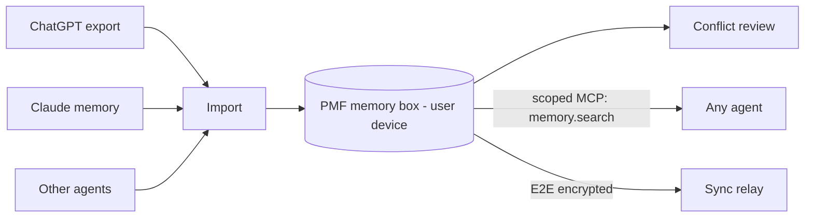

# Architecture — memory-box

## 1. Scope
A portable, user-owned memory layer that moves "what the AI knows about me" across assistants.
**MVP:** Portable Memory Format (PMF) JSON with an HMAC signature, importers (text, markdown,
JSON, JSONL), categorisation, near-duplicate merge, single-valued conflict detection, exports
(markdown, prompt block with a token budget, JSON) with sensitive-category redaction.
**Product:** E2E-encrypted sync, MCP server with per-agent scopes, push-back writers into assistants.

## 2. System context

## 3. Data model
`Fact{id, text, category, sources[], created, confidence}`. `sensitive` is derived from the category
(health, location, people). The document is `{format: "pmf/0.1", facts[], signature}`, with the
signature computed as HMAC-SHA256 over the canonical JSON of the facts.

## 4. Merge & conflict semantics
- **Merge:** token-Jaccard ≥ 0.7 (stopwords removed) means the same fact. Add the source, bump
  confidence by 0.1, and keep the newest wording.
- **Conflicts:** single-valued attributes (home location, employer, name, age) extracted by
  pattern. More than one distinct value means it's surfaced for the user to resolve, never
  auto-resolved.
- **Export ordering:** highest confidence first, packed greedily into the token budget.

## 5. Design decisions
- **User-owned file format first, service second.** Portability is the product, so the format
  must outlive the company.
- **Never auto-resolve conflicts.** People move and change jobs, and silently picking one is worse than asking.
- **Redaction happens at export,** not import, so the box stays complete and each agent gets the
  minimum it needs.

## 6. Production architecture
A local-first app (SQLite + PMF export), an MCP server exposing `memory.search/add/forget` with
per-agent category scopes (via agent-okta), and sync through an E2E-encrypted blob relay
(libsodium sealed boxes; the server holds ciphertext only).

## 7. Risks
Assistants may not allow import or export, so browser-extension capture is the fallback.
Regex extraction for conflicts is brittle, and a small local model is the planned upgrade.
